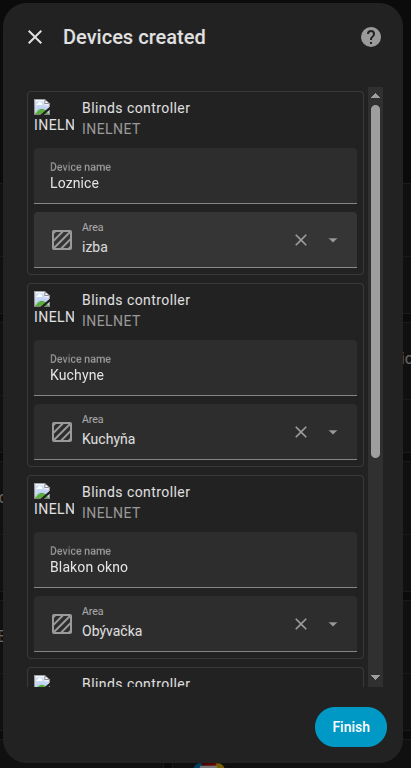

# INELNET Blinds

Home Assistant integration for an INELNET blinds controller on the local network. Each channel is one shutter. The controller accepts commands and does not report position, so every shutter shows open, stop and close.

The integration adds a sidebar dashboard named **INELNET**. Each shutter is its own card. Shutters that have a room are grouped under that room. There is no button that moves every shutter at once.

If anybody is interested in supporting my "sleepless" nights (working mostly between 23:00-3:00) on different projects press:

[](https://www.buymeacoffee.com/hadatko)

Thank you ;)

Ideas are welcome. But PRs are welcome more ;)

## What you get

- One cover per channel: open, stop, close. Usable from the dashboard, from automations, or with `cover.open_cover`, `cover.close_cover` and `cover.stop_cover`.
- A generated dashboard that updates when you add a channel, rename a shutter, or assign a room. Edits you make on that dashboard are replaced the next time the list of shutters or rooms changes.
- Three extra buttons per channel, disabled until you enable them: short move up, short move down, and programming mode for pairing a remote. The same three actions are available as device actions.

## Installation

Home Assistant 2025.1 or newer.

### HACS

1. In HACS, open **Integrations**.
2. If INELNET Blinds is not in the list yet, open the three-dot menu, choose **Custom repositories**, and add `https://github.com/Hadatko/inelnet_ha` with category **Integration**.
3. Download **INELNET Blinds** and restart Home Assistant.

### Manual

Copy `custom_components/inelnet` into the Home Assistant `config/custom_components/inelnet` directory and restart.

## Setup

1. **Settings → Devices & services → Add integration** and search for **INELNET Blinds**.
2. Enter the controller address and every channel number, separated by commas (`1` or `1,2,3`). A channel is any positive integer. One device is created per channel.

   

3. Open the **INELNET** dashboard in the sidebar. Assign a device to a room if you want the card under that room. The dashboard picks the room up on its own.

   

4. To add or remove a channel later, open the integration, then **Configure**. You do not add the controller a second time.

The controller is contacted once during setup. After that Home Assistant only sends a command when you press a button. Position is never read, so the state stays unknown and both directions stay available.

## For developers

Commands are HTTP POST requests to `http://<host>/msg.htm` with body `send_ch=<channel>&send_act=<code>`.

| Action | Code |
| --- | --- |
| Stop | 144 |
| Up | 160 |
| Short up | 176 |
| Down | 192 |
| Short down | 208 |
| Program | 224 |

The client is the [inelnet-api](https://pypi.org/project/inelnet-api/) package. Source is in `inelnet_api/`. One channel is one `InelnetChannel(host, channel)`.

### Publish the library

1. Copy `.env.pypi.example` to `.env.pypi` and set the PyPI token. The username stays `__token__`. `.env.pypi` is gitignored.
2. Run `./scripts/upload_pypi.sh` (`build` and `twine` are required).

Before a new upload, bump `version` in `pyproject.toml` and `inelnet_api/__init__.py`. A tag such as `v1.0.1` also publishes through [GitHub Actions](.github/workflows/publish-pypi.yml) when the `PYPI_API_TOKEN` secret is set.

### Tests

```bash
pip install -e . && pip install -r requirements_test.txt
pytest tests/ tests_inelnet_api/ -v
```

The integration tests use `pytest-homeassistant-custom-component`.
