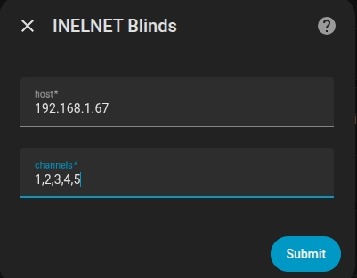

# inelnet_ha

Home Assistant integration for controlling INELNET blinds via REST API. You define all channels in one setup step (IP + comma-separated channel list). Each channel becomes one device with four entities: one cover (open/close/stop) and three buttons (Short move up, Short move down, Programming mode).

## Installation

For full setup steps see **[Setup guide →](https://github.com/Hadatko/inelnet_ha#)**.

1. Copy the `custom_components/inelnet` folder into your Home Assistant `<config>/custom_components/inelnet` (or clone the repo and symlink).
2. Restart Home Assistant.
3. **Settings → Devices & services → Add integration** → search for "INELNET Blinds".
4. Enter the controller **IP address** (e.g. `192.168.1.67`) and **all channel numbers** comma-separated (e.g. `1` or `1,2,3`). Channels are positive integers. One device per channel is created.  
   **Channel definition** (entered when adding the integration):

   

5. Optionally assign each channel to a room in Home Assistant (**Channel → Room**):

   

6. Each device has **4 entities**: the cover (open/close/stop) plus three buttons (Short move up, Short move down, Programming mode).

## Usage

- **Cover** – open/close/stop via UI or `cover.open_cover`, `cover.close_cover`, `cover.stop_cover`.
- **Buttons** – one entity per action: Short move up, Short move down, Programming mode (for pairing a remote). Use in dashboards or automations.
- **Device Actions** – the same actions are also available when building automations/scenes as device actions.

## Technical details

The integration uses the [inelnet-api](https://pypi.org/project/inelnet-api/) Python package to talk to the controller. The API sends POST requests to `http://<host>/msg.htm` with body `send_ch=<channel>&send_act=<code>`. Codes: 144 stop, 160 up, 176 up_short, 192 down, 208 down_short, 224 program.

### inelnet-api library (PyPI)

The blinds API is published as a separate package **inelnet-api**. Source is in the `inelnet_api/` directory. One channel = one `InelnetChannel(host, channel)` instance.

**Publishing to PyPI:**

1. Copy `.env.pypi.example` to `.env.pypi` and set your PyPI token (keep username as `__token__`). `.env.pypi` is in `.gitignore` and will not be committed.
2. Run (you need `build` and `twine` installed):

```bash
./scripts/upload_pypi.sh
```

The script loads credentials from `.env.pypi` and runs `python3 -m build` and `twine upload dist/*`. After code changes, update `version` in `pyproject.toml` and `inelnet_api/__init__.py`, then run `./scripts/upload_pypi.sh` again.

**Automated publish (recommended):** Push a version tag (e.g. `v1.0.0`) to trigger [GitHub Actions](.github/workflows/publish-pypi.yml). Add repository secret `PYPI_API_TOKEN` with your PyPI token. PyPI versions should [match tagged releases](https://developers.home-assistant.io/docs/api_lib_index/).

## Testing

Tests follow the same style as Home Assistant core integrations (pytest, `pytest-homeassistant-custom-component`).

```bash
pip install -e . && pip install -r requirements_test.txt
pytest tests/ tests_inelnet_api/ -v
```

Requires a compatible Home Assistant core environment (e.g. install `homeassistant` in the same venv or use the same Python as HA). The `pytest-homeassistant-custom-component` package provides the `hass` and `enable_custom_integrations` fixtures.

---

If anybody is interested in supporting my "sleepless" nights (working mostly between 23:00-3:00) on different projects press:

[](https://www.buymeacoffee.com/hadatko)

Thank you ;)

Ideas are welcome. But PRs are welcome more ;)
